# Medication Reminder System

## Section A: Project Introduction

The Medication Reminder System is a console-based application developed in C to help users manage their medicines and keep track of their medication schedules. The main objective of this project is to provide a simple way to add, view, search, and delete medicine records while also tracking taken and missed doses. The system includes features such as pill stock management, low stock alerts, and missed dose notifications. It uses structures, arrays, pointers, functions, recursion, and file handling to manage and store medicine records permanently in a text file.

## Section B: Features & Test Cases (Execution Scenarios)

### Case 1: Entering Zero as Menu Choice

- **Description:** Tests how the system responds when the user enters `0` as the menu choice.
- **Inputs:** Enter `0`.
- **Expected Output:** The system displays an invalid choice message and asks the user to select a number between 1 and 6.
- **Screenshot:**

  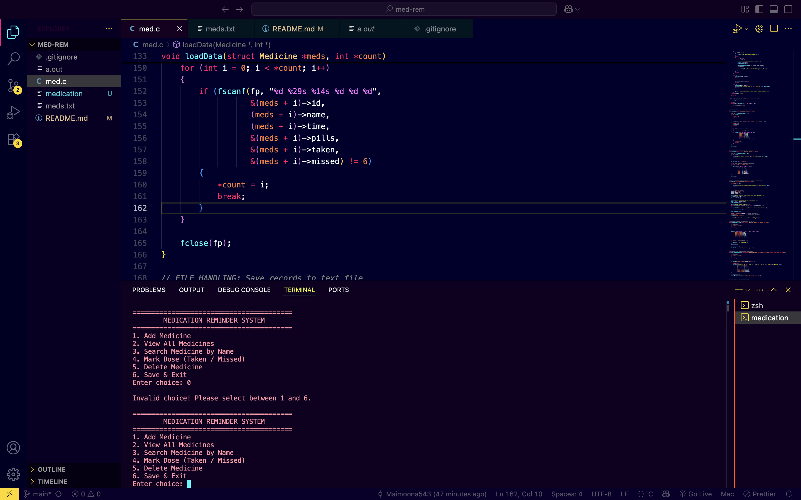

### Case 2: Adding a New Medicine

- **Description:** Tests whether the user can add a new medicine by entering its name, scheduled time, and number of pills.
- **Inputs:**
  - Medicine Name: Panadol
  - Scheduled Time: 08:00AM
  - Number of Pills: 10
- **Expected Output:** The medicine is added successfully, assigned an ID, and saved in the text file.
- **Screenshot:**

  

### Case 3: Viewing All Medicines

- **Description:** Tests whether the system displays all previously added medicine records.
- **Inputs:** Select option 2 from the main menu.
- **Expected Output:** A table displaying medicine ID, name, scheduled time, remaining pills, taken doses, and missed doses.
- **Screenshot:**

  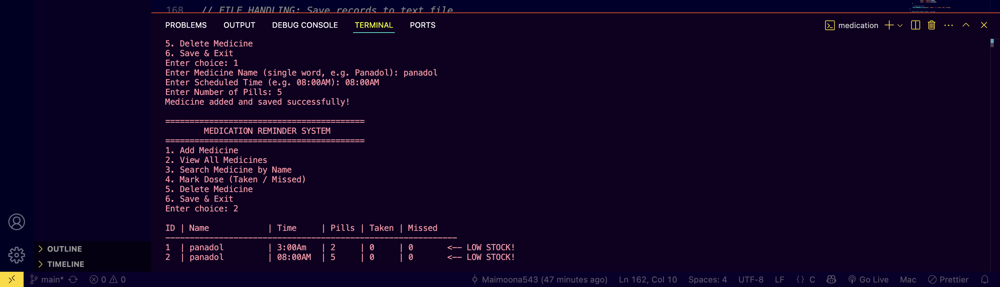

### Case 4: Searching for a Medicine

- **Description:** Tests the medicine search functionality using the exact medicine name.
- **Inputs:** Enter `Panadol`.
- **Expected Output:** The system displays the matching medicine's ID, name, scheduled time, pill count, taken doses, and missed doses.
- **Screenshot:**

  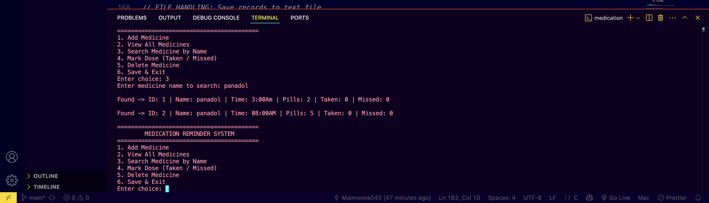

### Case 5: Marking a Dose as Taken

- **Description:** Tests whether the user can mark a medicine dose as taken and update the remaining pill count.
- **Inputs:**
  - Medicine ID: 1
  - Status: 1 (Taken)
- **Expected Output:** The system confirms that the dose was taken, increases the taken count, decreases the remaining pill count by one (if pills are available), and displays a low stock alert when applicable.
- **Screenshot:**

  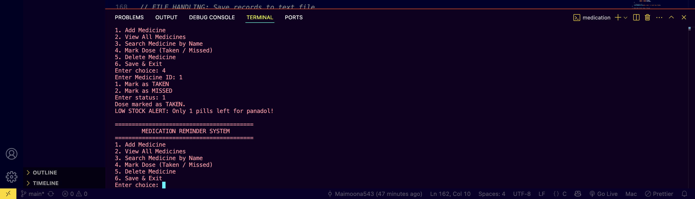

### Case 6: Marking a Dose as Missed

- **Description:** Tests whether the system can record a missed medicine dose.
- **Inputs:**
  - Medicine ID: 1
  - Status: 2 (Missed)
- **Expected Output:** The missed dose count increases, and a caregiver alert message displays the medicine name and scheduled time.
- **Screenshot:**

  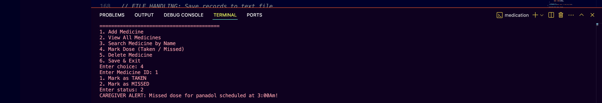

### Case 7: Deleting a Medicine

- **Description:** Tests whether a medicine record can be deleted using its unique ID.
- **Inputs:** Enter the ID of an existing medicine.
- **Expected Output:** The selected medicine is deleted, the remaining records are shifted, their IDs are updated, and the file is saved.
- **Screenshots:**

  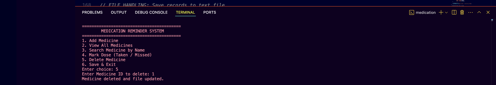

  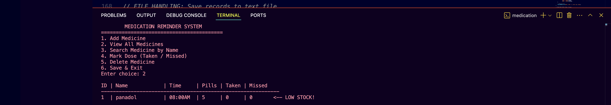

### Case 8: Invalid Menu Input

- **Description:** Tests how the system handles non-numeric input in the main menu.
- **Inputs:** Enter `abc` instead of a menu number.
- **Expected Output:** The system displays an invalid input message and asks the user to enter a number.
- **Screenshot:**

  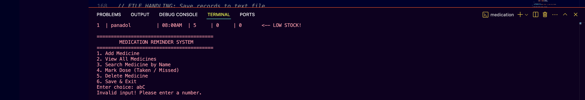

### Case 9: Invalid Medicine ID

- **Description:** Tests the system's response when the user enters a medicine ID that does not exist.
- **Inputs:** Select option 4 and enter medicine ID `99`.
- **Expected Output:** The system displays a message stating that the medicine ID was not found.
- **Screenshot:**

  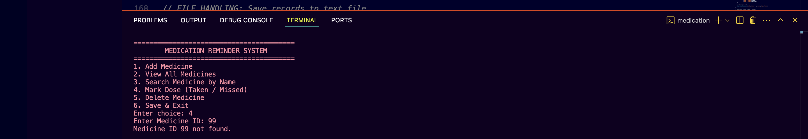

### Case 10: Invalid Number of Pills

- **Description:** Tests whether the system prevents users from entering a negative number of pills.
- **Inputs:**
  - Select option 1.
  - Medicine Name: TestMed
  - Scheduled Time: 10:00AM
  - Number of Pills: -3
  - Enter a valid number: 5
- **Expected Output:** The system rejects the negative number, asks for a valid non-negative number, and adds the medicine after valid input is entered.
- **Screenshots:**

  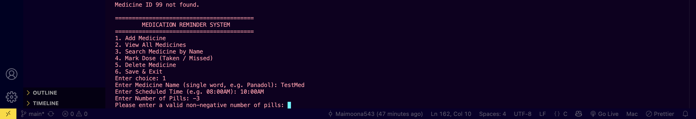

  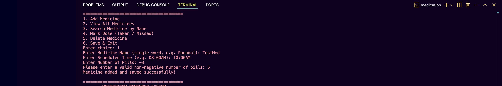

## 3. Project Technologies & Concepts

The following C programming concepts are implemented in this project:

- Structures
- Arrays
- Pointers and Pointer Arithmetic
- Functions and Function Prototypes
- Recursion
- File Handling (`fopen`, `fscanf`, `fprintf`, `fclose`)
- Loops and Conditional Statements
- String Handling

## 4. Instructions to Clone and Execute

### Step 1: Clone the Repository

Open your terminal or command prompt and execute:

```bash
git clone https://github.com/Maimoona543/medication-Reminder-sys.git
```

Navigate to the project directory:

```bash
cd medication-Reminder-sys
```

### Step 2: Compile the Code

Make sure GCC is installed on your system.

Compile the source code using:

```bash
gcc med.c -o medication
```

### Step 3: Run the Program

**Windows (Command Prompt):**

```bash
medication.exe
```

**macOS / Linux:**

```bash
./medication
```

## 5. Data Storage

The system stores medicine records in a text file named `meds.txt`.

Each record contains:

- Medicine ID
- Medicine Name
- Scheduled Time
- Number of Pills
- Taken Dose Count
- Missed Dose Count

Previously saved records are automatically loaded when the program starts.

## 6. Project Directory Structure

```text
medication-Reminder-sys/
│
├── med.c
├── meds.txt
├── README.md
├── .gitignore
│
└── assets/
    ├── case-1.png
    ├── case-2.png
    ├── case-3.png
    ├── case-4.png
    ├── case-5.png
    ├── case-6.png
    ├── case-7.png
    ├── case-7.2.png
    ├── case-8.png
    ├── case-9.png
    ├── case-10.png
    └── case-10.2.png
```

## 7. Team Members

- Maimoona Akhter
- Marium yazdan
- Ayesha shafique

## 8. Project Note

This project is developed for academic purposes as part of a C Programming course. It is a console-based medicine management system and does not provide automatic phone notifications or real-time reminders.
